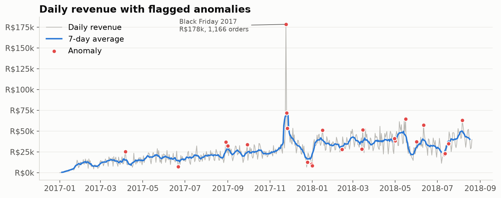
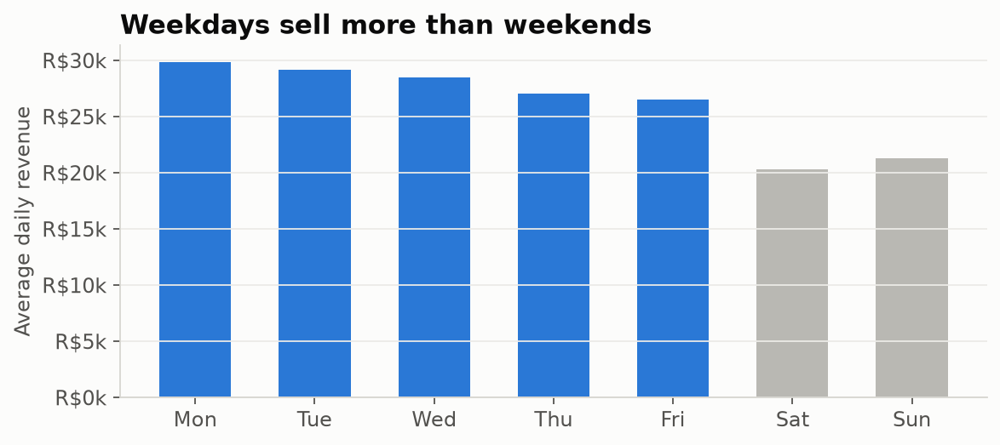
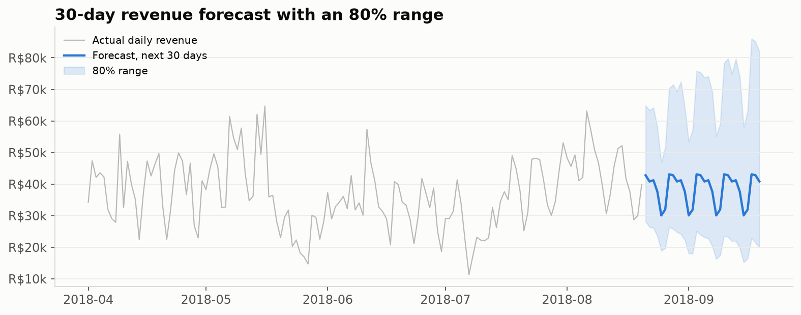
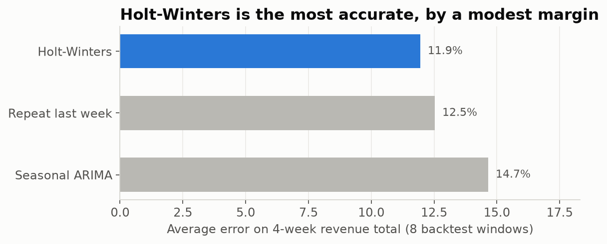

# Sales Forecast and Anomaly Detection

What does normal daily demand look like for an online marketplace, which days break the pattern, and what should the business expect next month? This project answers that for **~97,000 orders (Jan 2017 – Aug 2018)** from a Brazilian e-commerce marketplace, with a Python analysis and a Power BI dashboard.

**Tools:** Python (pandas, statsmodels), Matplotlib, Jupyter, Power BI (DAX, Power Query)

- **Notebook:** [`notebooks/sales_forecast_and_anomalies.ipynb`](notebooks/sales_forecast_and_anomalies.ipynb)
- **Power BI:** [`powerbi/`](powerbi/) with the dashboard data and a [build guide with every DAX measure](powerbi/POWERBI_GUIDE.md)

<!-- After building the dashboard: add images/dashboard.png and uncomment the line below

-->

## Key findings

| # | Finding | Evidence |
| --- | --- | --- |
| 1 | **Black Friday 2017 was the biggest anomaly by far** | R$178k and 1,166 orders in one day, almost 7x a typical day earlier that November |
| 2 | **Most dips are holidays, not problems** | 25 days flagged: 13 spikes and 12 dips. Dips include Christmas, New Year, Carnival and Labour Day |
| 3 | **Weekdays sell more than weekends** | Monday revenue is 15% above the weekly average; Saturday is 22% below |
| 4 | **The forecast is useful, but the margin over a simple rule is small** | Missed the 4-week revenue total by 12.1% on average, vs 13.2% for "repeat last week" and 16.7% for seasonal ARIMA |







## Method

1. **Built a clean daily table.** Joined orders and payments and removed canceled and unavailable orders. Kept the full, stable period (1 Jan 2017 – 20 Aug 2018), because the platform was still ramping up in 2016 and collection stops in late August 2018. Missing days are filled with zero.
2. **Detected anomalies with STL decomposition.** Daily revenue is split into trend, weekly seasonality and residual. A day is flagged when its residual is more than 5 robust standard deviations (median absolute deviation) from normal. The Power BI version adds a simpler rolling 28-day z-score in DAX.
3. **Forecast with Holt-Winters** (damped trend, 7-day seasonality) on log revenue, after smoothing out anomaly days so Black Friday doesn't inflate the forecast.
4. **Backtested honestly.** The model was trained 8 separate times, each only on data before a 4-week window in 2018, and compared with what actually happened. A seasonal ARIMA and a "repeat last week" baseline were scored the same way.
5. **Quantified uncertainty.** 2,000 simulated futures give an 80% range for each day and for the 30-day total.



*Holt-Winters beat the baseline in 6 of 8 windows, but the average gain is only about one percentage point. For planning, the 80% range is more useful than the single forecast number.*

## Run it yourself

```bash
git clone https://github.com/rjodhani-data/sales-forecast-anomaly-detection.git
cd sales-forecast-anomaly-detection
pip install -r requirements.txt
```

1. Download the [Brazilian E-Commerce Public Dataset by Olist](https://www.kaggle.com/datasets/olistbr/brazilian-ecommerce) from Kaggle.
2. Copy `olist_orders_dataset.csv` and `olist_order_payments_dataset.csv` into the `data/` folder.
3. Open the notebook and run all cells. Charts go to `images/`, and the dashboard data goes to `powerbi/`.

The raw data files are not included because of their size. The two small dashboard files in `powerbi/` are included, so the Power BI part works without running Python.

## Project structure

```
├── notebooks/sales_forecast_and_anomalies.ipynb   # Analysis, anomalies, forecast, backtest
├── powerbi/
│   ├── daily_sales.csv          # Daily orders, revenue, AOV and anomaly flags
│   ├── forecast_30d.csv         # 30-day forecast with 80% range
│   └── POWERBI_GUIDE.md         # Step-by-step dashboard build with all DAX
├── images/                      # Charts used in this README
├── data/                        # Raw Olist CSVs go here (not included)
└── requirements.txt
```

## Data source

Olist, *Brazilian E-Commerce Public Dataset*, published on Kaggle under CC BY-NC-SA 4.0.

## Author

**Rajvi Jodhani** · Data Analyst · [Portfolio](https://rjodhani-data.github.io) · [LinkedIn](https://www.linkedin.com/in/rajvi-jodhani) · [GitHub](https://github.com/rjodhani-data)
